# 基于web的多媒体素材管理系统--论文

> 🎓 **计算机毕业设计 · 基于web的多媒体素材管理系统--论文**
>
> 本仓库只放**项目介绍 + 运行截图**（截图是站点带水印的原图，存在仓库 `images/` 里）。
>
> 👉 **完整可运行源码 / 数据库脚本 / 部署文档：[点我获取](https://geekcode.top/archives/%E5%9F%BA%E4%BA%8Eweb%E7%9A%84%E5%A4%9A%E5%AA%92%E4%BD%93%E7%B4%A0%E6%9D%90%E7%AE%A1%E7%90%86%E7%B3%BB%E7%BB%9F-%E8%AE%BA%E6%96%87?utm_source=github)**
>
> 💬 咨询微信：**ir9372**　|　🌐 更多项目：[极客代码 geekcode.top](https://geekcode.top/?utm_source=github)
>
> 📌 项目详情页：<https://geekcode.top/archives/%E5%9F%BA%E4%BA%8Eweb%E7%9A%84%E5%A4%9A%E5%AA%92%E4%BD%93%E7%B4%A0%E6%9D%90%E7%AE%A1%E7%90%86%E7%B3%BB%E7%BB%9F-%E8%AE%BA%E6%96%87?utm_source=github>

<table><td width="230" align="center"> <b>扫码加微信 ir9372</b></td><td valign="middle">📦 源码 = 项目介绍 + 全部运行截图 + 数据库 + 部署文档 👉 点上方任意截图，直接跳到 <b>极客代码 geekcode.top</b> 详情页</td></table>

---

<h1>基于web的多媒体素材管理系统--论文</h1>
<h2>项目概述</h2>

本项目名为“基于web的多媒体素材管理系统”，旨在构建一个集资源管理、素材展示与信息交流于一体的综合性Web平台。系统核心功能涵盖多媒体资源与素材的分类管理、详细信息展示、用户评论互动以及公告发布。适用人群包括需要共享或获取教学/设计素材的教师、学生及普通用户，以及负责内容审核与维护的后台管理员。技术架构上，后端采用 Spring Boot 框架结合 MyBatis-Plus 进行数据持久化操作，利用 Shiro 实现安全认证与权限控制；前端采用 Vue 集成方案，实现了前后端分离的开发模式，确保了系统的可扩展性与维护性。

<h2>技术架构</h2>

本系统采用经典的前后端分离架构设计，具体技术选型如下：

<ol>
<li><strong>后端架构</strong>：</li>
</ol>
<ul>
<li><strong>核心框架</strong>：使用 <code>spring-boot-starter-web</code> 作为基础 Web 容器，提供 RESTful API 接口服务。</li>
<li><strong>数据持久层</strong>：集成 <code>mybatis-spring-boot-starter</code> 和 <code>mybatis-plus</code>，简化 SQL 编写与数据库交互，提高开发效率。底层数据库连接池由 <code>spring-boot-starter-jdbc</code> 管理，驱动使用 <code>mysql-connector-java</code>。</li>
<li><strong>安全机制</strong>：引入 <code>shiro-spring</code> 模块，负责用户身份认证（Authentication）和授权（Authorization），确保系统访问的安全性。</li>
<li><strong>辅助组件</strong>：使用 <code>commons-lang3</code> 处理通用工具逻辑，<code>validation-api</code> 进行参数校验，<code>protobuf-java</code> 可能用于特定场景的数据序列化或通信优化。</li>
</ul>
<ol start="2">
<li><strong>前端架构</strong>：</li>
</ol>
<ul>
<li>项目类型为 <code>vue-integrated</code>，表明前端基于 Vue.js 生态构建，并与后端紧密集成。前台导航包含首页、资源信息、素材信息等模块，后台通过路由 <code>/forum</code>, <code>/news</code> 等管理各类业务实体。</li>
</ul>
<ol start="3">
<li><strong>数据库设计要点</strong>：</li>
</ol>
<ul>
<li>基于 Controller 列表推断，数据库主要包含以下核心表结构：</li>
<li><strong>用户相关</strong>：<code>yonghu</code> (用户), <code>jiaoshi</code> (教师)。</li>
<li><strong>内容相关</strong>：<code>ziyuanxinxi</code> (资源信息), <code>sucaixinxi</code> (素材信息), <code>news</code> (公告/新闻), <code>aboutus</code> (关于我们), <code>config</code> (系统配置)。</li>
<li><strong>分类相关</strong>：<code>ziyuanleixing</code> (资源类型), <code>sucaileixing</code> (素材类型)。</li>
<li><strong>交互相关</strong>：<code>discussziyuanxinxi</code> (资源评论), <code>discusssucaixinxi</code> (素材评论), <code>forum</code> (论坛/信息交流)。</li>
</ul>

<a href="https://geekcode.top/archives/%E5%9F%BA%E4%BA%8Eweb%E7%9A%84%E5%A4%9A%E5%AA%92%E4%BD%93%E7%B4%A0%E6%9D%90%E7%AE%A1%E7%90%86%E7%B3%BB%E7%BB%9F-%E8%AE%BA%E6%96%87?utm_source=github" title="查看完整源码">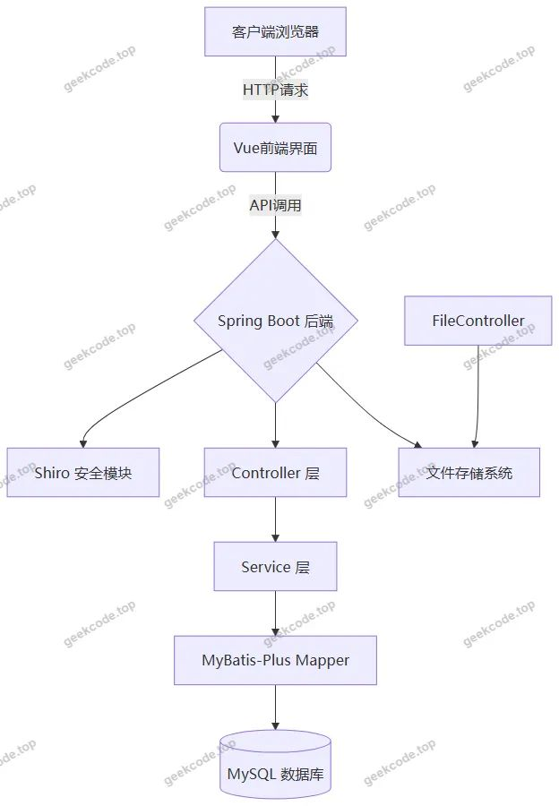</a>

<h2>功能模块</h2>

根据源码中的 Controller 定义及截图所示的前后台路由，系统功能划分为前台用户端和后台管理端两部分。

<h3>1. 前台用户端功能</h3>
<ul>
<li><strong>首页展示</strong>：系统入口，聚合展示最新资源、素材及公告信息。</li>
<li><strong>资源信息管理 (<code>ziyuanxinxi</code>)</strong>：</li>
<li>浏览资源列表：查看不同分类下的多媒体资源详情。</li>
<li>资源评论：用户对特定资源发表评价（对应 <code>DiscussziyuanxinxiController</code>）。</li>
<li><strong>素材信息管理 (<code>sucaixinxi</code>)</strong>：</li>
<li>浏览素材列表：查看各类设计或教学素材。</li>
<li>素材评论：用户对素材进行互动讨论（对应 <code>DiscusssucaixinxiController</code>）。</li>
<li><strong>信息交流 (<code>forum</code>)</strong>：提供论坛或留言板功能，支持用户之间的公开交流。</li>
<li><strong>公告信息 (<code>news</code>)</strong>：查看系统发布的官方通知、新闻或更新日志。</li>
<li><strong>关于我们 (<code>aboutus</code>)</strong>：展示系统介绍、联系方式等静态信息页面。</li>
<li><strong>个人中心</strong>：</li>
<li><strong>收藏列表</strong>：用户可查看已收藏的资源或素材（对应 <code>StoreupController</code>）。</li>
<li><strong>账户管理</strong>：虽无详细菜单截图，但通常包含登录、注册及基本信息修改功能。</li>
</ul>
<h3>2. 后台管理端功能</h3>
<ul>
<li><strong>系统登录</strong>：管理员及教师角色的身份验证入口。</li>
<li><strong>资源类型管理 (<code>ziyuanleixing</code>)</strong>：增删改查资源的分类标签，便于前台筛选。</li>
<li><strong>素材类型管理 (<code>sucaileixing</code>)</strong>：管理素材的分类体系。</li>
<li><strong>资源信息管理 (<code>ziyuanxinxi</code>)</strong>：</li>
<li>发布新资源、编辑现有资源信息、删除过时资源。</li>
<li>上传资源关联的多媒体文件。</li>
<li><strong>素材信息管理 (<code>sucaixinxi</code>)</strong>：</li>
<li>维护素材库，包括新增、修改、下架素材记录。</li>
<li><strong>用户管理 (<code>yonghu</code>)</strong>：查看所有注册用户信息，进行账号状态管理（如禁用/启用）。</li>
<li><strong>教师管理 (<code>jiaoshi</code>)</strong>：专门针对教师角色的信息维护与管理。</li>
<li><strong>评论管理</strong>：</li>
<li>资源评论管理 (<code>discussziyuanxinxi</code>)：审核、删除违规或不实评论。</li>
<li>素材评论管理 (<code>discusssucaixinxi</code>)：监控素材下方的用户反馈。</li>
<li><strong>论坛管理 (<code>forum</code>)</strong>：维护社区秩序，管理帖子内容。</li>
<li><strong>公告管理 (<code>news</code>)</strong>：发布和管理系统公告及新闻内容。</li>
<li><strong>关于我们管理 (<code>aboutus</code>)</strong>：更新系统简介页的内容。</li>
<li><strong>系统配置 (<code>config</code>)</strong>：设置网站名称、Logo、版权信息等全局参数。</li>
<li><strong>文件管理 (<code>FileController</code>)</strong>：处理上传文件的存储与下载路径映射。</li>
</ul>
<h2>用户角色与权限</h2>

系统基于 Shiro 框架实现权限控制，主要涉及以下三类角色：

<ol>
<li><strong>超级管理员 (Admin)</strong></li>
</ol>
<ul>
<li><strong>权限范围</strong>：拥有系统最高权限。</li>
<li><strong>核心职责</strong>：</li>
<li>全量数据管理：可对所有资源、素材、类型、公告、关于我们内容进行 CRUD（增删改查）操作。</li>
<li>用户治理：管理所有普通用户和教师账号，重置密码或封禁账号。</li>
<li>内容审核：全面监管评论区、论坛发帖，有权删除任何不当言论。</li>
<li>系统配置：修改网站基础配置参数。</li>
</ul>
<ol start="2">
<li><strong>教师 (Jiaoshi)</strong></li>
</ol>
<ul>
<li><strong>权限范围</strong>：介于管理员与普通用户之间，具备特定的内容贡献或管理权限。</li>
<li><strong>核心职责</strong>：</li>
<li>根据后台存在独立的 <code>/jiaoshi</code> 路由和 <code>JiaoshiController</code>，推测教师可在后台登录并管理与其相关的素材或资源信息。</li>
<li>可能具备发布特定类别素材或查看其名下学生/用户反馈的权限。</li>
<li>参与信息交流，在论坛中可能拥有标识性的发言权限。</li>
</ul>
<ol start="3">
<li><strong>普通用户 (Yonghu)</strong></li>
</ol>
<ul>
<li><strong>权限范围</strong>：前台主要使用者，权限受限。</li>
<li><strong>核心职责</strong>：</li>
<li>浏览与检索：查看资源、素材、公告及关于我们信息。</li>
<li>互动参与：对资源和素材发表评论，在论坛发帖交流。</li>
<li>个人资产：收藏喜欢的资源或素材，管理个人账户信息。</li>
<li><strong>限制</strong>：无法进入后台管理系统，无权修改或删除他人内容，仅能管理自己的评论和收藏。</li>
</ul>
<h2>项目特色与创新点</h2>
<ol>
<li>
<strong>多维度素材分类体系</strong>：
   系统不仅区分了“资源”与“素材”两大主体，还分别为两者建立了独立的类型管理体系（<code>ziyuanleixing</code> 和 <code>sucaileixing</code>）。这种细粒度的分类策略使得海量多媒体数据的检索更加精准，解决了传统系统中素材查找困难的问题。

</li>
<li>
<strong>强互动的社区化运营</strong>：
   区别于单纯的下载站，本项目引入了“信息交流”（Forum）和双重评论机制（针对资源和素材分别有 <code>discuss</code> 表）。这增强了用户粘性，形成了“获取-使用-反馈-再获取”的良性闭环，促进了多媒体素材的优胜劣汰和质量提升。

</li>
<li>
<strong>精细化的角色隔离</strong>：
   除了常规的管理员和用户，系统专门设计了“教师”角色及其独立的管理路由。这一创新点契合了教育或多媒体教学场景的需求，允许教师在系统中扮演更积极的策展人或管理者角色，而非仅仅是内容的消费者。

</li>
<li>
<strong>标准化的前后端分离架构</strong>：
   采用 Spring Boot + MyBatis-Plus + Shiro 的经典组合，配合 Vue 前端，保证了系统的高内聚低耦合。Shiro 的引入确保了在未完全依赖 JWT 等传统 Token 机制的情况下，依然能提供成熟稳定的 Session 级安全管理，适合中小型毕设项目的快速迭代与安全需求。

</li>
</ol>
<h2>部署环境</h2>

为确保系统正常运行，需准备以下软硬件环境：

<ol>
<li><strong>硬件环境</strong>：</li>
</ol>
<ul>
<li>CPU: Intel Core i5 及以上</li>
<li>内存: 8GB 及以上</li>
<li>硬盘: 至少 50GB 可用空间（用于存放多媒体素材文件）</li>
</ul>
<ol start="2">
<li><strong>软件环境</strong>：</li>
</ol>
<ul>
<li><strong>操作系统</strong>: Windows 10/11, Linux (CentOS/Ubuntu) 或 macOS。</li>
<li><strong>JDK</strong>: Java Development Kit 1.8 或更高版本（建议 JDK 1.8 以兼容 Spring Boot 旧版稳定特性）。</li>
<li><strong>数据库</strong>: MySQL 5.7 或 8.0。需初始化对应的数据库脚本。</li>
<li><strong>后端运行环境</strong>: Maven 3.6+ (用于依赖管理和打包), Tomcat (内置于 Spring Boot，无需单独安装外部 Tomcat，但需确保端口 8080 未被占用)。</li>
<li><strong>前端运行环境</strong>: Node.js 14.x 或 16.x LTS 版本，npm 或 yarn 包管理器。</li>
<li><strong>开发工具</strong>: IntelliJ IDEA (推荐) 或 Eclipse (后端)，VS Code (前端)。</li>
</ul>
<ol start="3">
<li><strong>启动步骤简述</strong>：</li>
</ol>
<ul>
<li>导入 MySQL 数据库文件。</li>
<li>修改后端 <code>application.yml</code> 配置文件中的数据库连接 URL、用户名和密码。</li>
<li>在后端根目录执行 <code>mvn clean install</code> 编译项目。</li>
<li>运行主启动类启动后端服务。</li>
<li>在前端根目录执行 <code>npm install</code> 安装依赖。</li>
<li>执行 <code>npm run serve</code> (开发模式) 或 <code>npm run build</code> (生产模式) 启动前端应用。</li>
</ul>
<h2>五、技术特性</h2>
<ul>
<li>前后端集成部署，前端资源打包至后端 static 目录</li>
<li>使用 MyBatis-Plus 简化数据访问层开发</li>
<li>集成 Shiro 权限框架实现角色权限控制</li>
</ul>
<h2>六、功能模块截图</h2>
<h3>前台用户端</h3>
<h4>前台-关于我们列表</h4>

<h4>前台-教师列表</h4>

<a href="https://geekcode.top/archives/%E5%9F%BA%E4%BA%8Eweb%E7%9A%84%E5%A4%9A%E5%AA%92%E4%BD%93%E7%B4%A0%E6%9D%90%E7%AE%A1%E7%90%86%E7%B3%BB%E7%BB%9F-%E8%AE%BA%E6%96%87?utm_source=github" title="查看完整源码">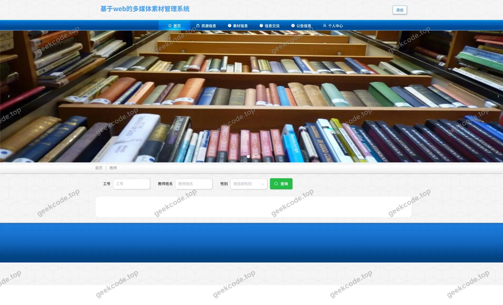</a>

<h4>前台-收藏列表</h4>

<a href="https://geekcode.top/archives/%E5%9F%BA%E4%BA%8Eweb%E7%9A%84%E5%A4%9A%E5%AA%92%E4%BD%93%E7%B4%A0%E6%9D%90%E7%AE%A1%E7%90%86%E7%B3%BB%E7%BB%9F-%E8%AE%BA%E6%96%87?utm_source=github" title="查看完整源码">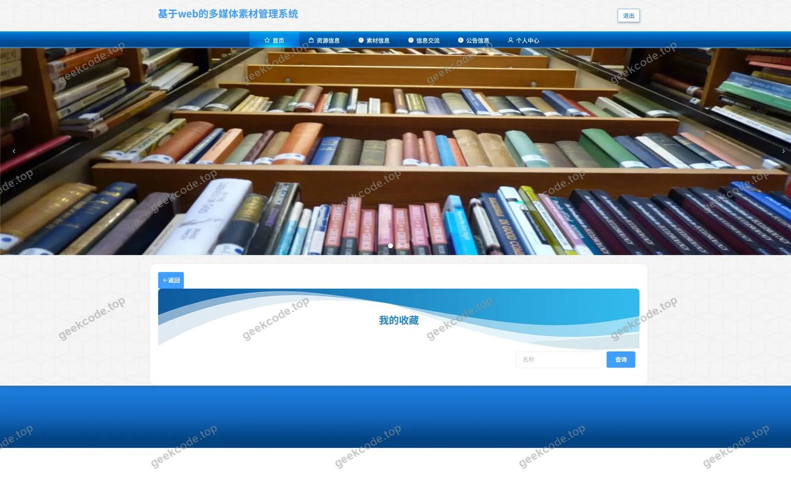</a>

<h4>前台-素材类型列表</h4>

<h4>前台-素材信息列表</h4>

<a href="https://geekcode.top/archives/%E5%9F%BA%E4%BA%8Eweb%E7%9A%84%E5%A4%9A%E5%AA%92%E4%BD%93%E7%B4%A0%E6%9D%90%E7%AE%A1%E7%90%86%E7%B3%BB%E7%BB%9F-%E8%AE%BA%E6%96%87?utm_source=github" title="查看完整源码">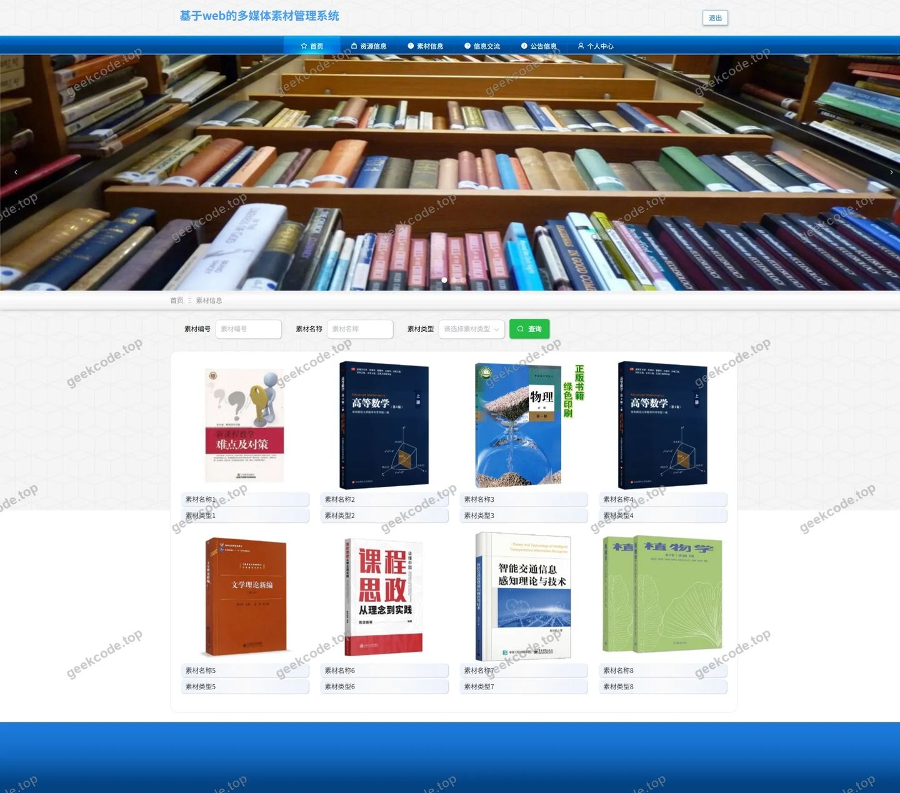</a>

<h4>前台-资源类型列表</h4>

<a href="https://geekcode.top/archives/%E5%9F%BA%E4%BA%8Eweb%E7%9A%84%E5%A4%9A%E5%AA%92%E4%BD%93%E7%B4%A0%E6%9D%90%E7%AE%A1%E7%90%86%E7%B3%BB%E7%BB%9F-%E8%AE%BA%E6%96%87?utm_source=github" title="查看完整源码">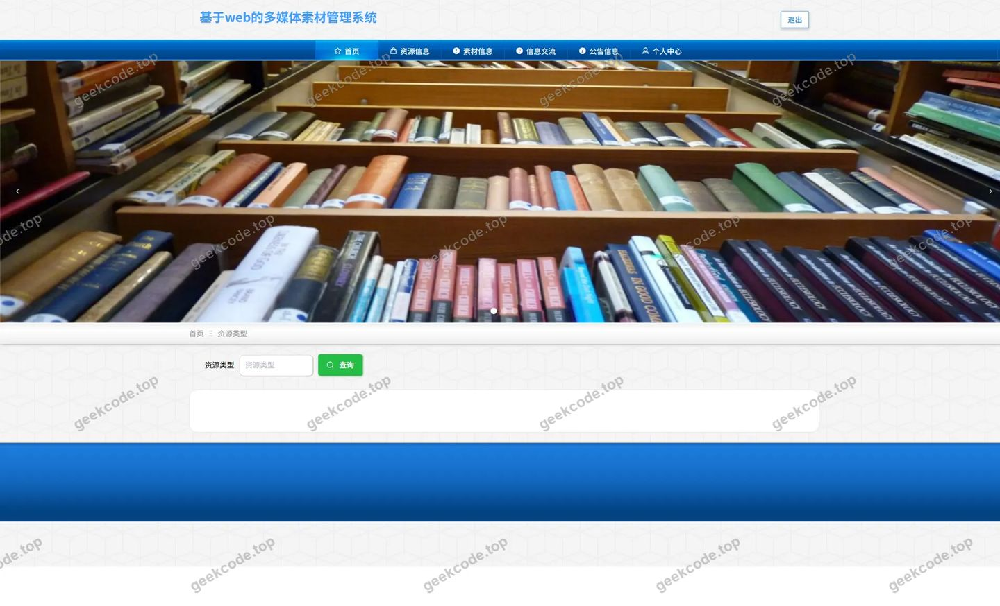</a>

<h4>前台-资源信息列表</h4>

<a href="https://geekcode.top/archives/%E5%9F%BA%E4%BA%8Eweb%E7%9A%84%E5%A4%9A%E5%AA%92%E4%BD%93%E7%B4%A0%E6%9D%90%E7%AE%A1%E7%90%86%E7%B3%BB%E7%BB%9F-%E8%AE%BA%E6%96%87?utm_source=github" title="查看完整源码">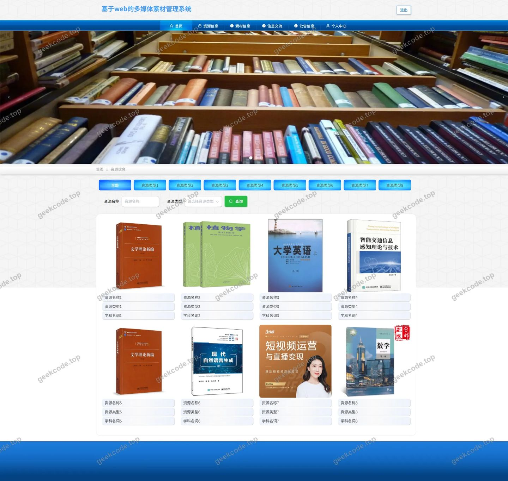</a>

<h4>前台-个人中心</h4>

<a href="https://geekcode.top/archives/%E5%9F%BA%E4%BA%8Eweb%E7%9A%84%E5%A4%9A%E5%AA%92%E4%BD%93%E7%B4%A0%E6%9D%90%E7%AE%A1%E7%90%86%E7%B3%BB%E7%BB%9F-%E8%AE%BA%E6%96%87?utm_source=github" title="查看完整源码">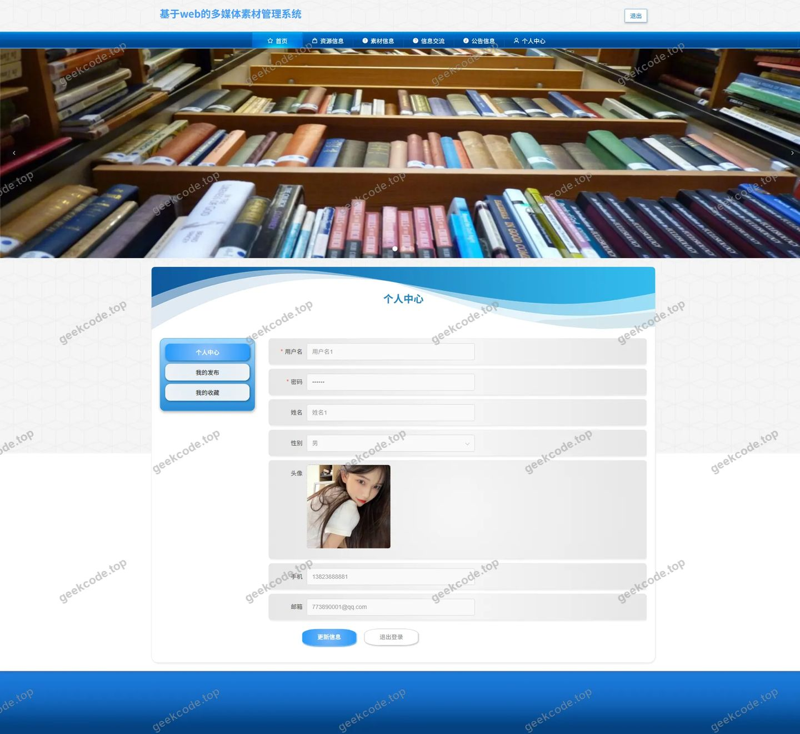</a>

<h4>前台-公告列表</h4>

<a href="https://geekcode.top/archives/%E5%9F%BA%E4%BA%8Eweb%E7%9A%84%E5%A4%9A%E5%AA%92%E4%BD%93%E7%B4%A0%E6%9D%90%E7%AE%A1%E7%90%86%E7%B3%BB%E7%BB%9F-%E8%AE%BA%E6%96%87?utm_source=github" title="查看完整源码">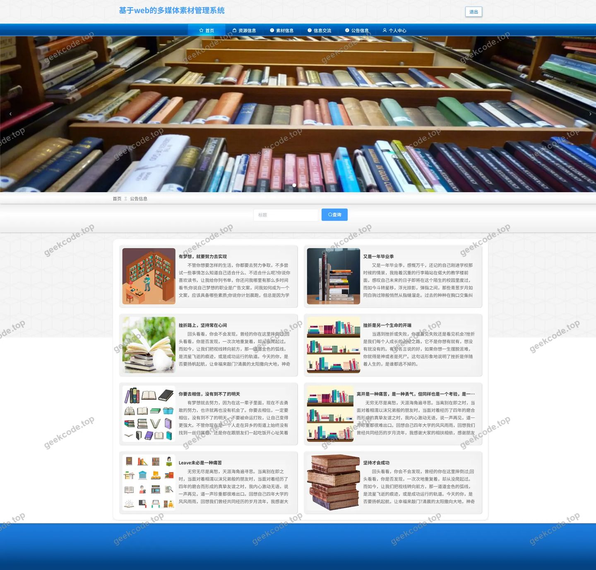</a>

<h3>后台管理端</h3>
<h4>后台-登录页</h4>

<h4>后台-公告信息</h4>

<a href="https://geekcode.top/archives/%E5%9F%BA%E4%BA%8Eweb%E7%9A%84%E5%A4%9A%E5%AA%92%E4%BD%93%E7%B4%A0%E6%9D%90%E7%AE%A1%E7%90%86%E7%B3%BB%E7%BB%9F-%E8%AE%BA%E6%96%87?utm_source=github" title="查看完整源码">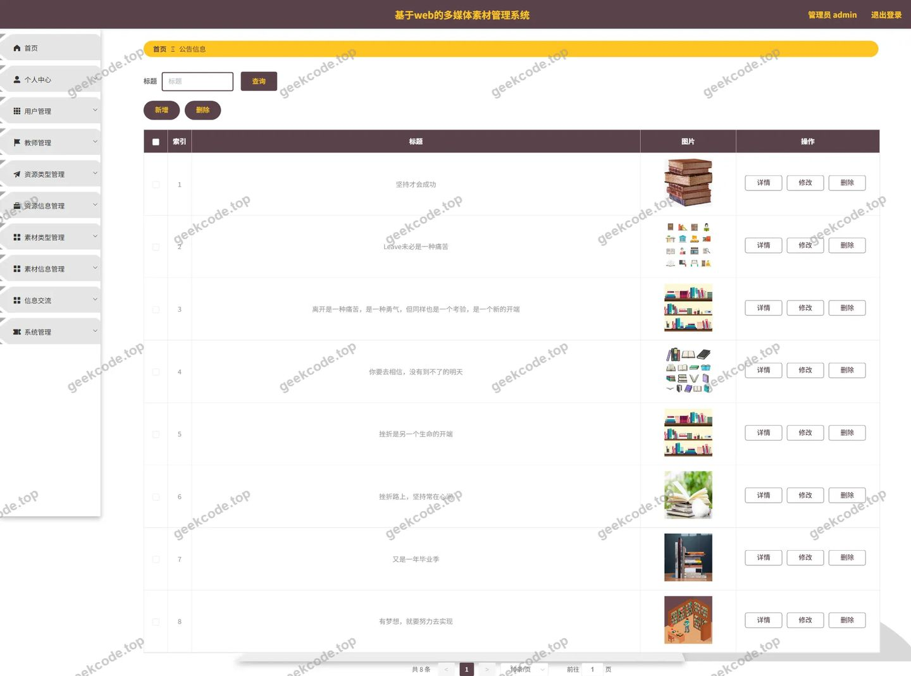</a>

<h4>后台-关于我们</h4>

<a href="https://geekcode.top/archives/%E5%9F%BA%E4%BA%8Eweb%E7%9A%84%E5%A4%9A%E5%AA%92%E4%BD%93%E7%B4%A0%E6%9D%90%E7%AE%A1%E7%90%86%E7%B3%BB%E7%BB%9F-%E8%AE%BA%E6%96%87?utm_source=github" title="查看完整源码">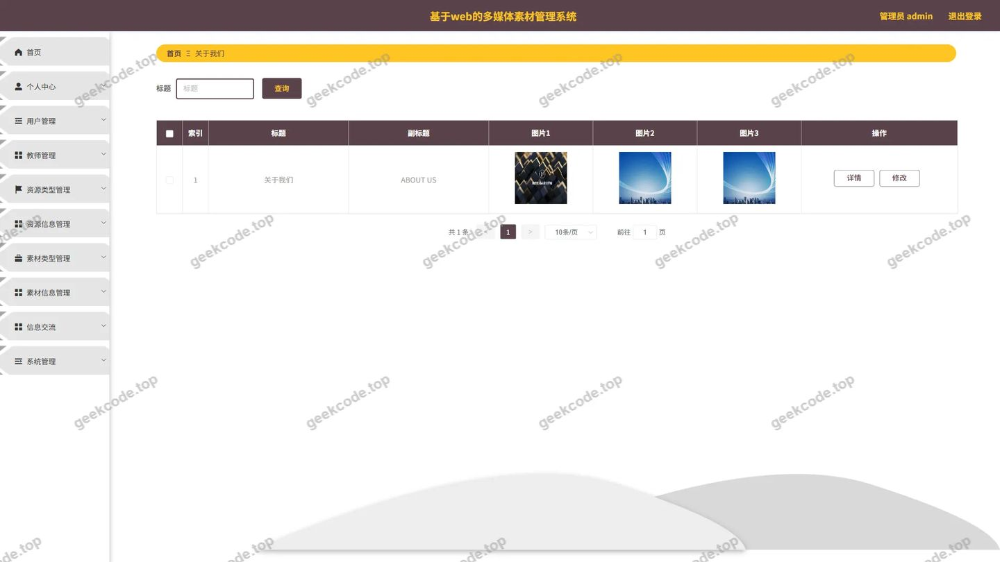</a>

<h4>后台首页</h4>

<a href="https://geekcode.top/archives/%E5%9F%BA%E4%BA%8Eweb%E7%9A%84%E5%A4%9A%E5%AA%92%E4%BD%93%E7%B4%A0%E6%9D%90%E7%AE%A1%E7%90%86%E7%B3%BB%E7%BB%9F-%E8%AE%BA%E6%96%87?utm_source=github" title="查看完整源码">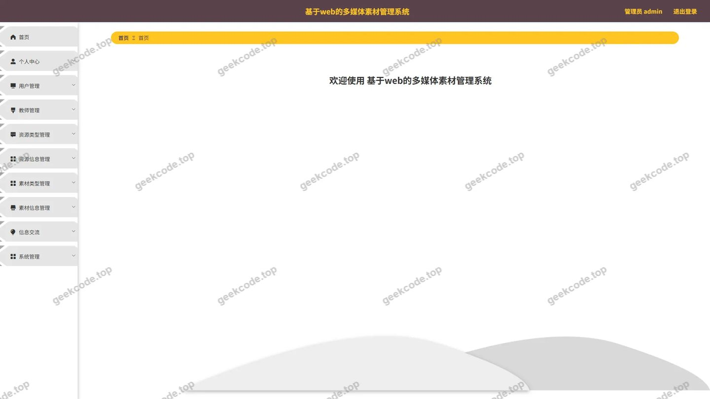</a>

<h4>后台-用户</h4>

<a href="https://geekcode.top/archives/%E5%9F%BA%E4%BA%8Eweb%E7%9A%84%E5%A4%9A%E5%AA%92%E4%BD%93%E7%B4%A0%E6%9D%90%E7%AE%A1%E7%90%86%E7%B3%BB%E7%BB%9F-%E8%AE%BA%E6%96%87?utm_source=github" title="查看完整源码">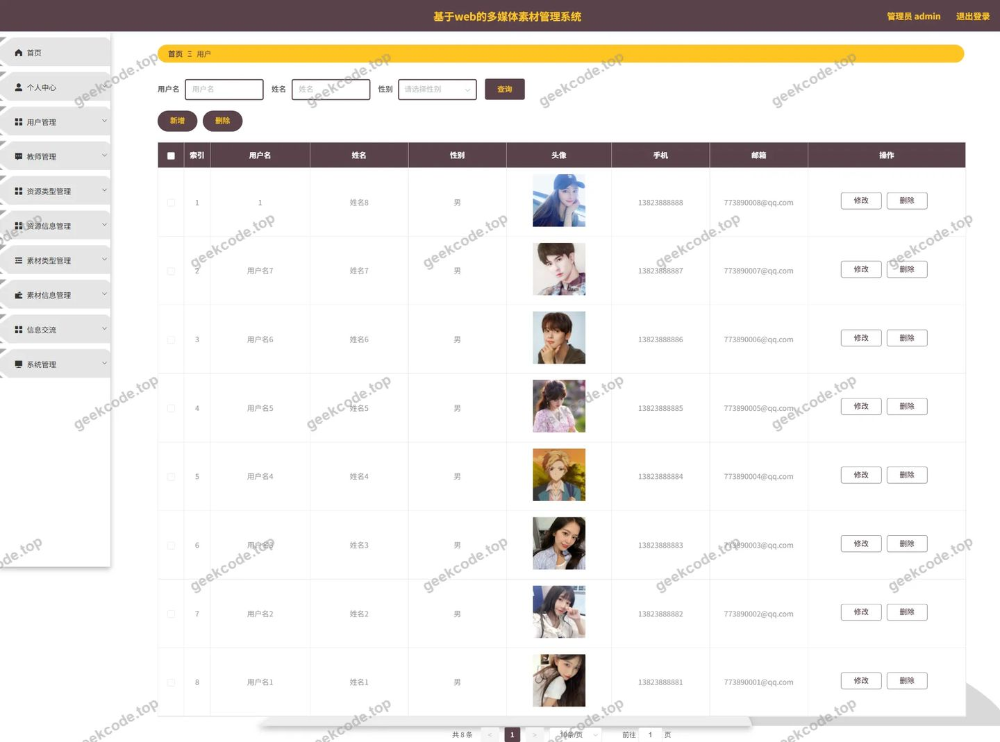</a>

<h4>后台-资源类型</h4>

<a href="https://geekcode.top/archives/%E5%9F%BA%E4%BA%8Eweb%E7%9A%84%E5%A4%9A%E5%AA%92%E4%BD%93%E7%B4%A0%E6%9D%90%E7%AE%A1%E7%90%86%E7%B3%BB%E7%BB%9F-%E8%AE%BA%E6%96%87?utm_source=github" title="查看完整源码">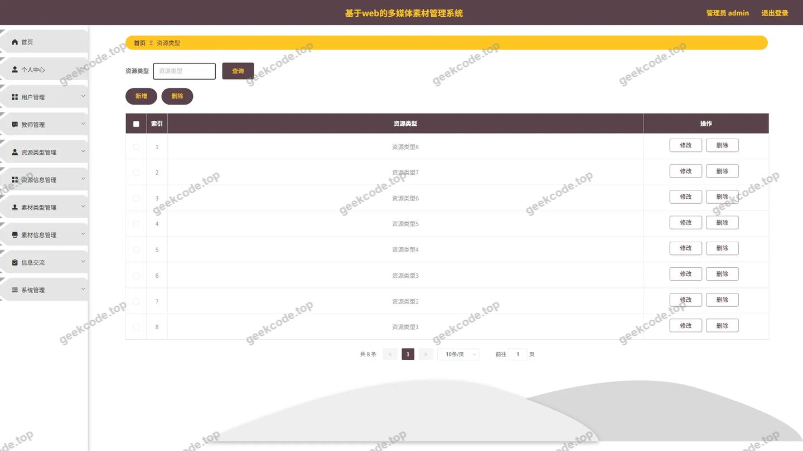</a>

<h4>后台-资源信息</h4>

<a href="https://geekcode.top/archives/%E5%9F%BA%E4%BA%8Eweb%E7%9A%84%E5%A4%9A%E5%AA%92%E4%BD%93%E7%B4%A0%E6%9D%90%E7%AE%A1%E7%90%86%E7%B3%BB%E7%BB%9F-%E8%AE%BA%E6%96%87?utm_source=github" title="查看完整源码">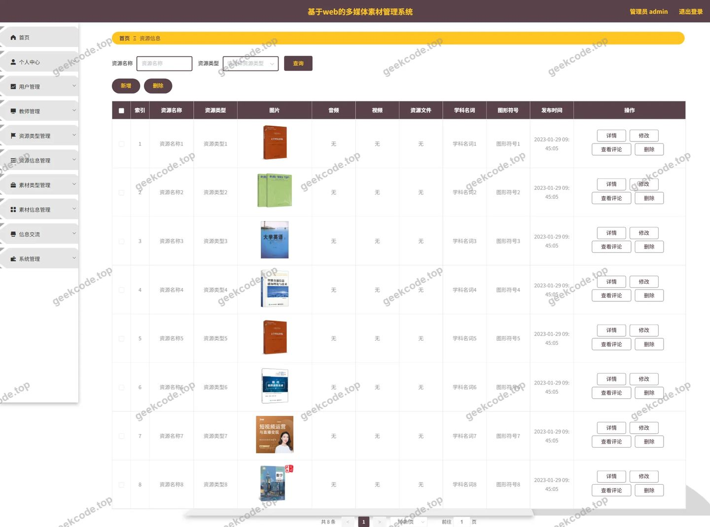</a>

<h4>后台-资源信息评论</h4>

<a href="https://geekcode.top/archives/%E5%9F%BA%E4%BA%8Eweb%E7%9A%84%E5%A4%9A%E5%AA%92%E4%BD%93%E7%B4%A0%E6%9D%90%E7%AE%A1%E7%90%86%E7%B3%BB%E7%BB%9F-%E8%AE%BA%E6%96%87?utm_source=github" title="查看完整源码">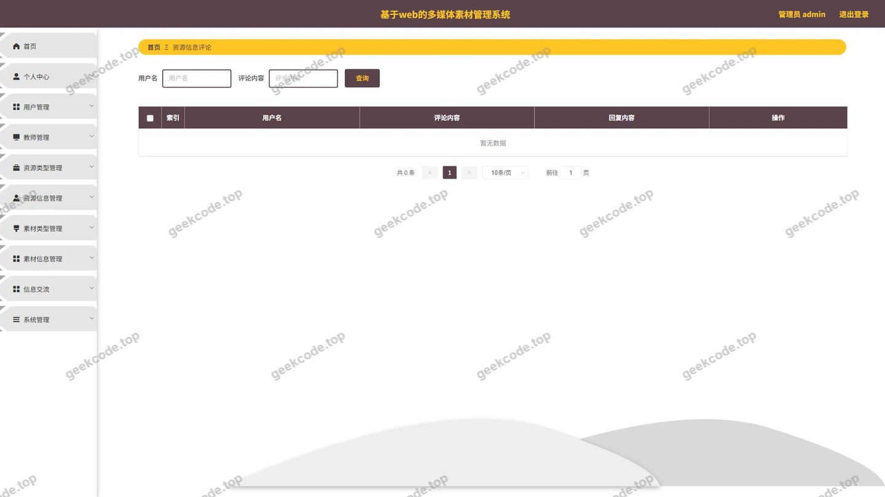</a>

---

## 获取完整源码

| 项目 | 说明 |
| --- | --- |
| 项目名 | 基于web的多媒体素材管理系统--论文 |
| 运行截图 | 本文 18 张（站点带水印原图，仓库 `images/` 目录） |
| 完整源码 | [https://geekcode.top/archives/%E5%9F%BA%E4%BA%8Eweb%E7%9A%84%E5%A4%9A%E5%AA%92%E4%BD%93%E7%B4%A0%E6%9D%90%E7%AE%A1%E7%90%86%E7%B3%BB%E7%BB%9F-%E8%AE%BA%E6%96%87?utm_source=github](https://geekcode.top/archives/%E5%9F%BA%E4%BA%8Eweb%E7%9A%84%E5%A4%9A%E5%AA%92%E4%BD%93%E7%B4%A0%E6%9D%90%E7%AE%A1%E7%90%86%E7%B3%BB%E7%BB%9F-%E8%AE%BA%E6%96%87?utm_source=github) |
| 咨询微信 | **ir9372**（备注：jingpin-yuanma） |
| 更多项目 | [极客代码 geekcode.top](https://geekcode.top/?utm_source=github) |

> 需要源码、部署、改配置、跑不起来等问题，加微信 ir9372 沟通，说明项目名即可。
